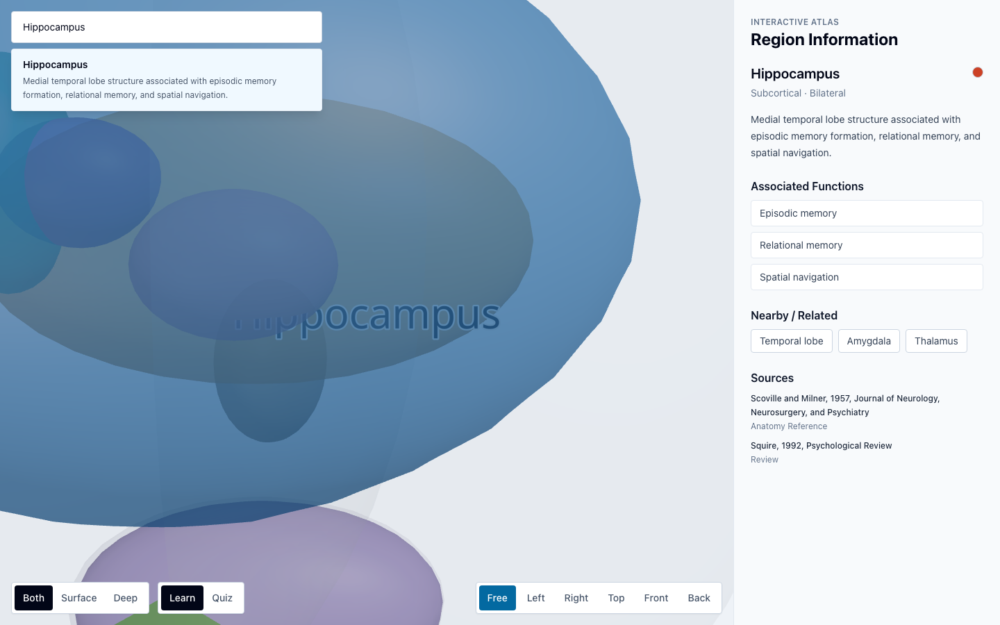

# MentiSphere

Interactive 3D brain learning app for exploring brain regions, practicing recall, and reading concise source-backed anatomy notes.

MentiSphere is currently an early learning-tool prototype. It has a working React/Three.js frontend, a FastAPI backend, shared starter region metadata, search, region details, camera/view controls, and quiz mode. The 3D anatomy is still a simplified educational proxy; real cortical surface and atlas meshes are planned.



## What Works Today

- Interactive 3D brain-region proxies with hover and selection states.
- Search by region name, anatomy term, or associated function.
- Region details with summaries, related regions, functions, and citations.
- Surface/deep/both view filters.
- Camera presets for common perspectives.
- Quiz mode for practicing region localization.
- FastAPI endpoints for region listing, lookup, and search.
- CI for frontend build/lint/typecheck and backend tests.
- Browser smoke tests for the main learning flows.

## Roadmap

The 12 proxy regions are the current state and are to be replaced by real anatomy:

- Real fsLR 32k and fsaverage cortical surfaces, colored by an atlas: HCP-MMP 1.0, Desikan-Killiany (DK/DKT), Harvard-Oxford, Julich-Brain, Brodmann and Schaefer 2018.
- Real subcortical meshes, including the Tian S4 subcortical atlas.
- A command-line tool, `menti`, with `resolve`, `at`, `show`, `snap` and `serve`: it resolves region names and coordinates to atlas parcels and produces links and snapshots of exact views.
- Overlays of your own result files, read from local paths.
- Function information only from cited sources.

Licensed atlas files and built data will live in a local folder outside git (`$MENTI_DATA`); your own result files stay where they are and are never copied. See [docs/DATA.md](docs/DATA.md).

See [docs/PROJECT_PLAN.md](docs/PROJECT_PLAN.md) for the detailed plan.

## Tech Stack

Frontend:

- React 18
- TypeScript
- Vite
- Three.js / React Three Fiber
- Drei
- Zustand
- Tailwind CSS

Backend:

- FastAPI
- Pydantic
- Pytest
- Python 3.12

Data/tooling:

- Shared region metadata in [data/metadata/regions.json](data/metadata/regions.json)
- Data pipeline in [pipeline/](pipeline/) with a license-gated source manifest (`pipeline/sources.yaml`)

## Repository Layout

```text
mentisphere/
  backend/              FastAPI API and backend tests
  data/metadata/        Shared starter region metadata
  docs/                 Planning, architecture and data notes
  frontend/             React/Vite frontend
  pipeline/             Source manifest and data pipeline
  scripts/              Repository checks (data guard)
```

## Requirements

- Node.js 20 recommended
- npm
- Python 3.12

## Setup

```bash
npm install
python3.12 -m venv .venv312
.venv312/bin/python -m pip install -r backend/requirements.txt
```

To build atlas data, set `MENTI_DATA` to a local folder outside the repository (see [docs/DATA.md](docs/DATA.md)). The pipeline stages that use it are not implemented yet.

## Development

Start both frontend and backend:

```bash
npm run dev
```

Local URLs:

- Frontend: http://127.0.0.1:3000
- Backend: http://127.0.0.1:8000

Useful commands:

```bash
npm run typecheck --workspace=frontend
npm run lint --workspace=frontend
npm run build --workspace=frontend
cd backend && ../.venv312/bin/python -m pytest
```

## API

Current endpoints:

```text
GET /api/health
GET /api/regions
GET /api/regions/{region_id}
GET /api/search?q=memory
```

## Data Notes

The current region metadata is a small educational starter set, not a complete anatomical atlas. Functional descriptions are deliberately conservative and should be treated as learning summaries, not medical advice.

Atlas assets are not bundled. Each source has a license entry in `pipeline/sources.yaml`, and a source will be used only after its terms are audited and a checksum is recorded. Downloaded files and built meshes will live in `$MENTI_DATA`, outside git. See [docs/DATA.md](docs/DATA.md).

## Status

This project is not ready for clinical, diagnostic, or research use. It is a learning-oriented prototype under active development.

## Security

Please report suspected vulnerabilities privately. See [SECURITY.md](SECURITY.md).

## License

MIT. See [LICENSE](LICENSE).
